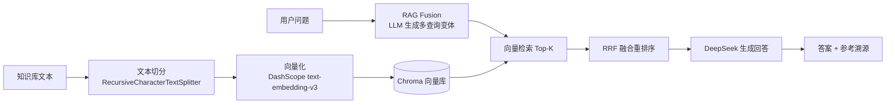

# RAG 知识库问答系统

基于 **LangChain + Chroma** 的检索增强生成（Retrieval-Augmented Generation）问答系统。支持 **RAG Fusion 多查询融合**与 **RRF 重排序**，提供 **Streamlit Web 界面**与**命令行**两种交互方式，答案可溯源到具体文本块。

[](https://www.python.org/)
[](https://www.langchain.com/)
[](https://www.trychroma.com/)
[](https://streamlit.io/)

## ✨ 特性

- **端到端 RAG 管线**：文档切分 → 向量化 → 入库 → 检索 → 生成
- **RAG Fusion 检索优化**：由 LLM 生成多个查询变体，从不同角度检索，提升召回率
- **RRF 重排序**：Reciprocal Rank Fusion 融合多路检索结果，输出带分数的 Top-K 文本块
- **答案可溯源**：每次回答附参考文本块、来源文档与融合得分，降低"幻觉"风险
- **双交互模式**：Streamlit Web UI（上传文档 / 知识库管理 / 聊天）+ 命令行问答
- **密钥安全**：API 密钥通过 `.env` 环境变量管理，`gitignore` 排除，避免泄露

## 🧱 技术栈

| 模块 | 技术 | 说明 |
|------|------|------|
| LLM | DeepSeek `deepseek-chat` | 生成回答、查询变体 |
| Embedding | 阿里 DashScope `text-embedding-v3` | 1024 维向量化 |
| 向量库 | Chroma | 本地持久化，元数据溯源 |
| 编排 | LangChain（LCEL） | 问答链组装 |
| 界面 | Streamlit | Web UI |
| 配置 | python-dotenv | 环境变量加载 |

## 🏗️ 系统架构



**RAG Fusion 流程**：原始问题 → LLM 生成 N 个查询变体 →（原始问题 + 变体）各自检索 → RRF 对多路结果融合打分 → 取融合后 Top-K 作为上下文 → 生成回答。

## 📁 项目结构

```
RAG/
├── rag_chroma_QA_fusion.py   # 核心 RAG 管线（切分/融合/检索/生成）
├── web_ui.py                 # Streamlit Web 界面
├── 初级rag.py                # 简化版 RAG（NumPy 手工实现，便于理解原理）
├── launcher.py               # 启动器（自动打开浏览器）
├── 启动Web界面.bat            # Windows 一键启动脚本
├── knowledge/                # 示例知识库文档
├── pyproject.toml            # 依赖声明（uv 管理）
├── uv.lock                   # 锁定依赖版本
├── .env.example              # 环境变量模板
└── README.md
```

## 🚀 快速开始

### 1. 环境要求

- Python >= 3.14
- [uv](https://docs.astral.sh/uv/)（推荐，也可用 pip）

### 2. 安装依赖

```bash
uv sync
```

### 3. 配置密钥

复制环境变量模板并填入你的真实密钥：

```bash
cp .env.example .env
```

编辑 `.env`：

```ini
DEEPSEEK_API_KEY=你的DeepSeek密钥
DASHSCOPE_API_KEY=你的阿里云DashScope密钥
```

> 密钥获取：DeepSeek 开放平台、阿里云百炼（DashScope）控制台。`.env` 已在 `.gitignore` 中忽略，不会上传。

### 4. 启动

**方式 A：Web 界面（推荐）**

```bash
streamlit run web_ui.py
```

或双击 `启动Web界面.bat`（Windows），浏览器将自动打开 `http://localhost:8501`。

**方式 B：命令行交互**

```bash
python rag_chroma_QA_fusion.py
```

## 💡 使用说明

**Web 界面**：在左侧边栏上传 `.txt` 文档（支持 UTF-8 / GBK），系统自动切分并向量化入库；在聊天框提问，回答下方可展开查看检索到的参考文本块、来源与 RRF 得分。侧边栏可开关 RAG Fusion、清空聊天、重置知识库。

**命令行**：支持 `fusion off` / `fusion on` 切换多查询融合，`exit` 退出。首次运行可选择从文件或控制台录入知识库。

## 🔍 核心实现

- **中文友好切分**：`RecursiveCharacterTextSplitter` 自定义分隔符 `["\n\n", "\n", "。", "？", "！", "；", "，", " ", ""]`，`chunk_size=200`、`chunk_overlap=40`
- **查询变体生成**：Prompt 引导 LLM 生成 4 个不同角度的查询，最大化召回
- **RRF 融合**：`score(d) = Σ 1/(k + rank(d, q))`，`k=60`，融合多路检索结果并排序
- **可溯源回答**：System Prompt 要求"参考资料中无相关信息时如实告知，不编造"

## 📝 已知局限与改进方向

当前为**本地单机演示**，尚未生产化，已知差距包括：

- [ ] 检索 / 生成质量评测（召回率、答案忠实度）
- [ ] 用户鉴权与权限控制
- [ ] 日志、监控与告警
- [ ] 失败重试与降级机制
- [ ] 容器化部署与 CI/CD
- [ ] 更多文档格式支持（PDF、Word、Markdown）

## 📄 许可证

暂未指定。如需公开使用，建议补充 LICENSE（如 MIT）。
